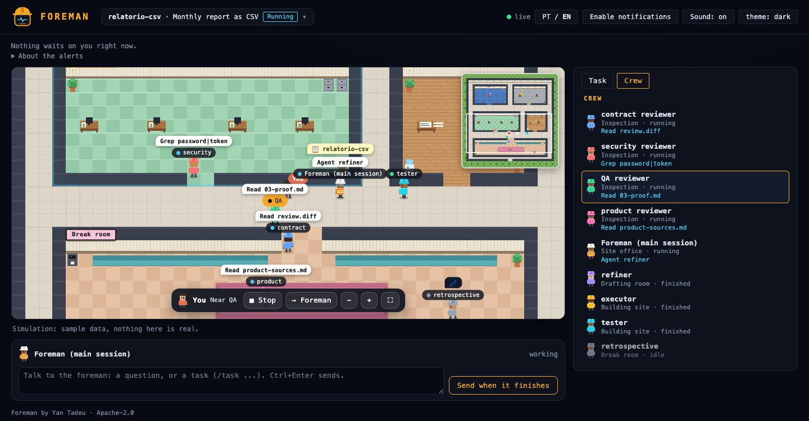
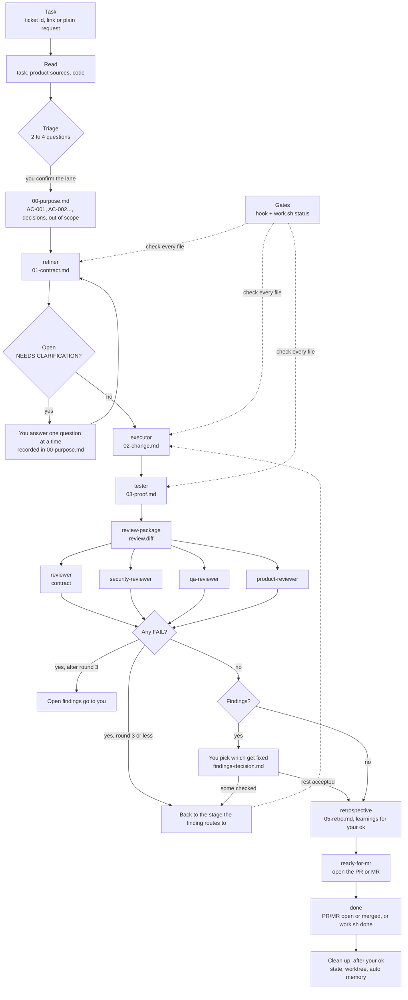
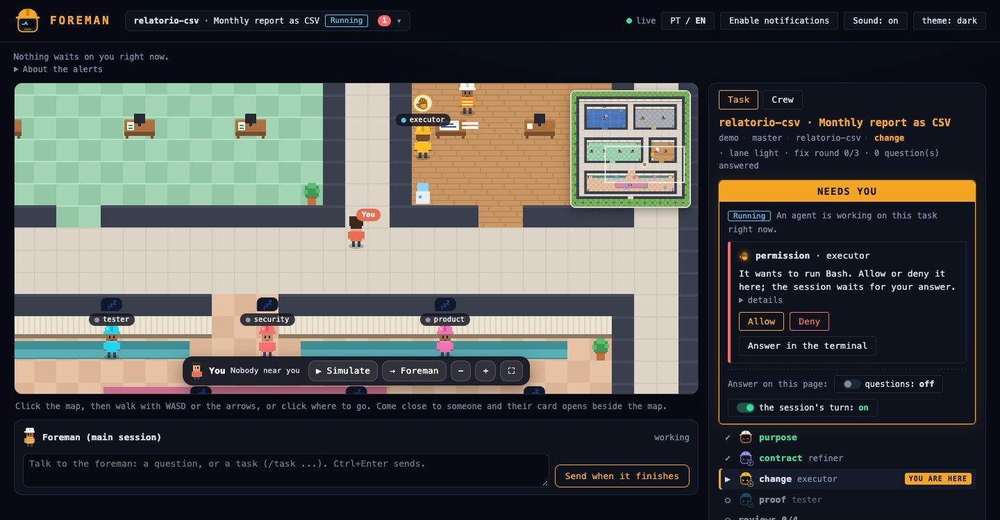
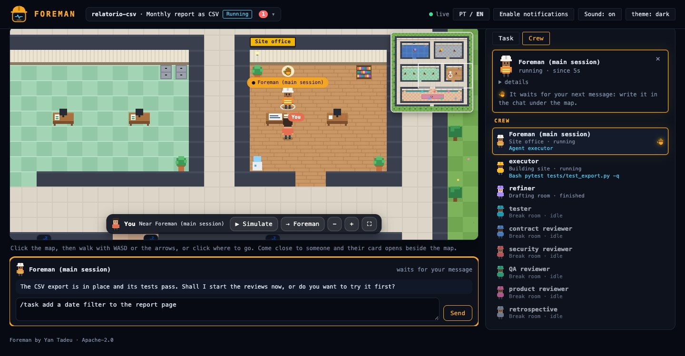
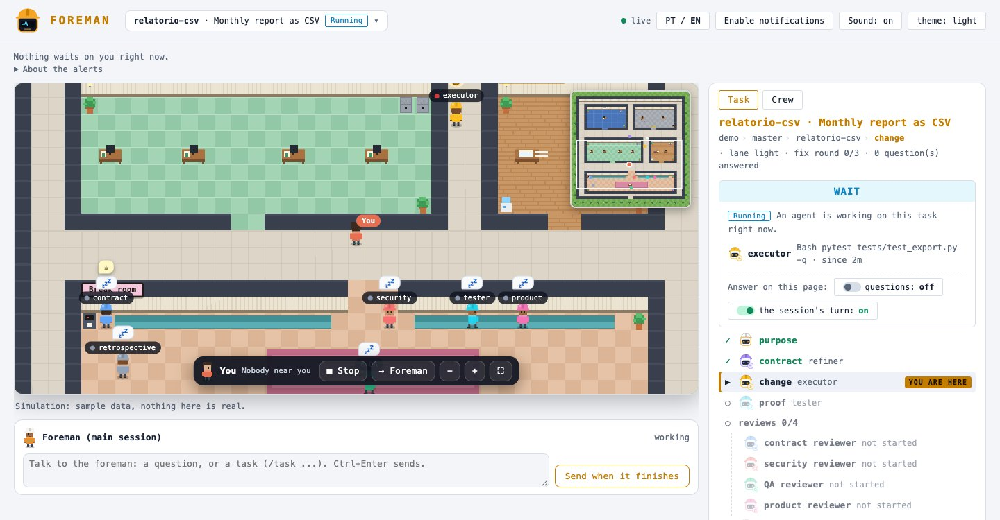
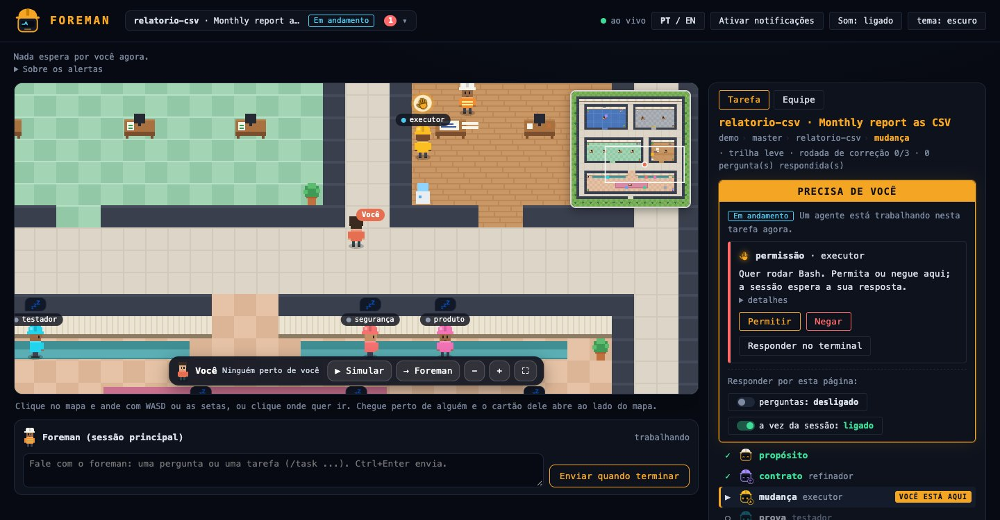

<p align="center"></p>

# Foreman

**Mission control for coding agents.** Foreman is a set of agents, commands, scripts and one hook that you install into a repository so coding
agents (Claude Code, Cursor, Codex, GitHub Copilot) work on a task in stages: specify,
implement, test, review, learn. Each stage writes its result to a file, and scripts check those
files before the next stage may start. Four reviewers check the result from different angles:
the contract, security, QA and product. A local dashboard shows every task as a tree of steps
and as a pixel-art construction site where you walk among the agents, workers in hard hats;
whatever needs you raises its hand, and you answer it on the page or in the chat with the session.

<p align="center"></p>
<p align="center"><sub>The site during a review: the four reviewers walk to the inspection room, the foreman hands out the task, and the chat with the main session stays open under the map. Stills below, in <a href="#the-dashboard">The dashboard</a>.</sub></p>


It does not depend on a task tracker or a documentation tool, and works without either: you
can describe what you want in plain words. If you use a tracker, you tell it which one during
setup.

## What you can do with it

- **Start a task with or without a tracker.** `/task add CSV export to the report page` is
  enough: the agent proposes the acceptance criteria and a short ID for you to confirm. With a
  tracker, `/task PROJ-123` or a link, and it reads the task through whatever reaches it (an
  MCP connector, `gh`, `glab`, a URL). See [Starting a task](#starting-a-task).
- **Get a triage before any code.** Two to four questions with a recommendation each, then a
  lane (None, Light, Full) that you confirm.
- **Keep the purpose on disk, with numbered criteria.** The acceptance criteria are written to
  `.work/<ID>/00-purpose.md` as `AC-001`, `AC-002`... Every stage cites them, and the gate
  refuses a contract or a proof that leaves one out.
- **Never build on a guess.** Where a choice is open, the refiner writes
  `[NEEDS CLARIFICATION: ...]` instead of picking. You answer one question at a time, the answer
  is recorded in the purpose, and the executor cannot start while a marker is open.
- **Get a written contract before implementation.** It includes how each criterion is proven
  and a mandatory section on what can fail without anyone noticing.
- **Get tests shown to fail without the fix.** The tester reverts the fix, shows the failure
  and restores it. A test that passes both ways does not count.
- **Get four independent reviews in parallel.** Contract, security, QA and product, each with
  its own reading list, all reading the same diff, each finding routed to the stage that must
  fix it.
- **Bounded fix loop.** Findings go back to the stage they name. After three executor rounds
  (configurable) the decision comes back to you.
- **Each decision belongs to one finding.** A decision line carries the finding's key
  (`work.sh findings <ID>` prints them), so a review that runs again and words a finding anew
  gets a new, open finding instead of inheriting an old decision. When a fix round ends, the
  agent marks what it fixed, and the page shows it as fixed.
- **Decide which findings get fixed.** When a reviewer passes with findings, you get one
  multiple-choice question listing them. The ones you check go back through the stages; the
  others are recorded as accepted, with the date. A later review reopens the decision.
- **Know when a task is really done.** Four verdicts are not "done". The dashboard says
  `findings` until you decide them, `ready-for-mr` until a pull or merge request exists, and
  `done` once one is open or merged on GitHub or GitLab (with a link), git sees the branch
  merged, or you run `work.sh done` for work with no PR. Then the agent suggests `/clear` so
  the next task starts with a clean context.
- **See every decision taken without you.** Agents record them in `ledger.md` as rulings: the
  decision, why, and the cost if it is wrong.
- **Learn between tasks.** A retrospective agent reads the finished task and proposes tagged
  learnings. You approve what goes into `LEARNINGS.md`, and each reviewer loads only its tags.
- **Catch product changes made during the task.** The refiner records the version of each
  product source it read. The product reviewer re-reads them at the end and reports what
  changed.
- **Register where product truth lives.** `/product-source <url|path>` reads the source, asks
  you what it decides and which source wins when two disagree, and records it.
  `/product-source sync` re-reads all of them.
- **Block stages that are not ready.** In Claude Code, a hook refuses to launch a stage before
  the ones it requires pass, and sends a stage back when its file is incomplete. In every tool,
  `work.sh status` runs the same checks and shows what is next.
- **Test the agents themselves.** Behavior evals run each agent on a fixture under pressure
  ("this is urgent, skip the edge cases") and check what it wrote.
- **Know what to do right now.** The dashboard opens on one line: **NEEDS YOU** or **WAIT**. NEEDS YOU lists
  exactly what waits on you for the task, each with its answer right there: a question to
  answer, a permission to allow or deny, the session's turn to reply to, findings to fix or
  accept, a PR to open. WAIT says which agent works on what, so you know nothing is stuck.
- **Answer everything from the page.** While the page is open, the hooks hold what the session
  waits for: a permission dialog (allow or deny, always), a question and the main session's turn
  (your message on the page continues the session). Questions and turns have a switch per
  worktree, on the page itself (it asks first and says the risk) or in the terminal (`work.sh ui
  answers on`, `work.sh ui turns on`). "Answer in the terminal" or closing the page hands any of
  them back at once.
- **Decisions reach the session at once.** A finding decided on the page goes to the session
  after its next tool call while it works, or, when it stopped to have the findings decided,
  the moment you decide. No message to type.
- **See where the task is.** The task is a tree of steps (purpose, contract, change, proof,
  reviews, decision, retrospective, closed) with "you are here" on the current one; each review
  carries its findings, and a step's file opens under it, in the Task panel beside the map. The
  map shows the same task as a virtual office in the style of Gather, in pixel art: one room per stage (drafting room,
  building site, inspection, site office) and a break room. You walk your own avatar (WASD, the
  arrows, or a click), and the camera follows you, with zoom and a minimap. The crew wear hard
  hats in their role's color, and the foreman (your main session) wears white. They walk the
  halls: to their desk when their stage starts, to the foreman with their file when it ends, and
  to the foreman's office when they raise a hand. Come close to someone and their card opens
  beside the map, where you answer them. Beside the map, the crew panel lists everyone. Under it,
  a chat bar sends the main session its next message when it holds its turn for the page.
  "▶ Simulate" plays a whole task with sample data.
- **Know when a session waits on you, anywhere.** Every Claude Code session that needs you, in
  any worktree and before any task exists, shows under "waiting on you", with a badge on the
  worktree, the count in the tab title, a beep (with a mute) and a browser notification that
  shows the kind of alert, never the command.
- **Clean up a finished task, memory included.** For a done task, the next session (or the
  "clean up" button on the dashboard) offers the retrospective first, so the learnings survive,
  then shows a plan of exactly what goes: the task's state, its worktree and local branch, and
  a review of Claude's auto memory about the task, where you pick which entries are deleted.
  Nothing goes before you confirm, a plan that changed meanwhile is refused, and a worktree with
  uncommitted or unpushed work or a live session is never removed.
- **Merge in the right order.** With several PRs or MRs open at once, `merge-order.py` says which
  goes first and why: a branch cut from another merges after it, two branches that change the
  same file merge in the order they started.
- **Your own specialists, in their own room.** `/flow-agent` interviews you and creates a
  specialized agent (a performance reviewer, an accessibility reviewer, a migration planner):
  its role file, its place in the flow (an extra review lens in parallel, a stage in the
  sequence, or a helper outside the flow), its room on the site (an existing one or a new
  one) and its look on the dashboard. The next task runs it with no other change. Move or remove
  it the same way.
- **Agents write in your language.** `language` in `flow.json` (asked by `/flow-setup`) is the
  language you read: every session is told so at its start, and writes its messages, questions
  and work files (purpose, contract, findings, rulings) in it. Only the keywords the scripts
  read stay in English, and the page translates those.
- **Every word in your language.** The page is in English or Portuguese (the browser decides,
  a button switches), and that covers everything: statuses, agents, verdicts, events, the
  messages to type. A command to copy is always whole: `cd <worktree> && claude "<message>"`,
  never a bare `claude`, and a command that needs a token reads it without echo, so it never
  lands in your shell history.
- **A calm page.** A finding is decided after a confirmation that says what the choice does; an
  alert you have seen can be dismissed (and shown again); the theme is dark, light or your
  system's; the live dot says "connecting" until the event stream answers.
- **Add plugins and MCP servers per stage.** `/flow-setup extensions` suggests the ones that fit
  your repository (Playwright for a web UI, the connector of your tracker, grill-me for a harder
  interview, ponytail against over-engineering), installs only what you approve and tells the
  agents what each one is for.
- **Change any of it later.** Rerun `/flow-setup` or one of its parts. It shows the current
  values as defaults and writes only what you change.
- **Use the same setup in Cursor, Codex and Copilot.** The Claude Code files are the source. A
  script generates Cursor rules and commands, a block in `AGENTS.md` for Codex, and Copilot
  agents and prompt files.

## How a task runs



Every box writes a file in `.work/<ID>/`. Agents pass each other file paths, not summaries. Each
answer starts with a fixed line (`Status: DONE | DONE_WITH_CONCERNS | NEEDS_CONTEXT | BLOCKED`
for the stages, `Verdict: PASS | PASS_WITH_FINDINGS | FAIL` for the reviewers), so the
orchestrator routes on that line, not on prose.

### Why each step is there

| Step | What it prevents | What you get |
| --- | --- | --- |
| Read before asking | Questions the code or the docs already answer | Fewer, better questions |
| Triage with a lane you confirm | The agent deciding scope, or treating a risky change as trivial | Effort matched to risk, and you decide it |
| `00-purpose.md` with `AC-###` ids | The goal drifting when a long conversation is summarized; a criterion silently dropped | One fixed reference every agent reads first, and coverage a script can check |
| `[NEEDS CLARIFICATION]` and one question at a time | The agent picking between two readings on its own | Every open choice decided by you and recorded |
| Refiner and the contract | The executor guessing; "done" with no definition | Criteria with their proof, and a list of what could fail without anyone noticing |
| Executor | Scope growing during implementation | It stops with `BLOCKED` when the contract is wrong, instead of improvising |
| Tester with the fix reverted | Tests that pass with or without the fix | Each criterion with a test shown to catch the defect |
| One review package | Reviewers reading different versions of the change | The same diff, new files included, for all four |
| Four parallel reviewers | Security, QA and product reviewed last, by the same agent that checked the logic | Four clean contexts, each owning one concern, in the time of one review |
| Product reviewer re-reading sources | Work delivered against a spec that changed mid-task | What changed since the contract, quoted |
| Bounded fix loop | Agents looping on a finding they cannot resolve | At most three rounds, then the decision is yours |
| Ledger of rulings | Decisions you never saw | Every decision taken without asking, with its cost if wrong |
| Findings decision | Minor findings fixed (or dropped) without you; a finding nobody saw | Each finding fixed or accepted by you, with the date |
| Retrospective | The same mistake in the next task | Proposed learnings you approve |
| Done only with a PR/MR | A task reported finished that nobody can review or merge | `done` means something exists to merge, or you closed it yourself |
| Cleanup after your ok | Stale worktrees, branches and memory of finished work misleading the next task | Exactly the listed items removed, learnings kept, nothing unpushed lost |
| Gates | A stage reporting "done" without its result, or starting too early | A missing section, an uncovered criterion or an open question stops the flow |

The cost is more tokens and a few minutes per task. The None lane skips refiner and tester for
trivial changes; the reviewers always run, and a docs-only change skips the QA reviewer.

## Add it to your repository

### 1. Check the prerequisites

`git`, `bash` and `python3` (standard library only). At least one of Claude Code, Cursor,
Codex or GitHub Copilot.

### 2. Get the kit

```bash
git clone https://github.com/yantadeu/foreman.git
```

### 3. Install it

```bash
./foreman/install.sh /path/to/your/repo                        # Claude Code, Cursor and Codex
./foreman/install.sh /path/to/your/repo --tools claude,codex   # only the tools you use
./foreman/install.sh /path/to/your/repo --tools claude,copilot # Copilot is opt-in
./foreman/install.sh /path/to/your/repo --replace              # replace differing files, backing yours up
```

The installer:

- copies the kit to `.claude/kit/`;
- creates the agents, commands, `flow.json`, `product-sources.md` and `LEARNINGS.md` only if
  they do not exist. When yours differs it keeps yours and tells you; with `--replace` it moves
  yours to `.agent-flow-backup/<time>/` first. The kit's originals stay in
  `.claude/kit/originals/` so you can compare and merge later;
- adds the hook to `.claude/settings.json` (Claude Code);
- generates `.cursor/rules/`, `.cursor/commands/` and a block in `AGENTS.md`. The rest of your
  `AGENTS.md` is kept;
- adds `/.work/` to `.gitignore`;
- runs the kit's test;
- lists the AI configuration your repository already had (see the next step).

### 4. Decide what to do with the AI configuration you already had

The installer ends with a list like this:

```
AI agent configuration already in this repository:
  overlap   CLAUDE.md                                  Claude Code, project instructions
  conflict  .claude/agents/reviewer.md                 Claude Code, subagent
  overlap   .cursorrules                               Cursor, legacy rules file
  overlap   .specify/memory/constitution.md            Spec Kit, spec workflow
  other     .mcp.json                                  Claude Code, MCP servers
```

- `conflict`: you have a file where the kit has one (an agent or command with the same name).
  Yours was kept.
- `overlap`: instructions or a workflow that may repeat or contradict the flow.
- `other`: configuration the flow does not touch.

Run `/flow-setup existing` (in Codex, "follow `.claude/commands/flow-setup.md`, part 0"). It
reads each item and proposes one action with the reason:

| Found | Usual action |
| --- | --- |
| Your agent or command with a kit name | **Merge**: the kit's structure, plus your stack, conventions and known traps |
| `CLAUDE.md`, `AGENTS.md`, Copilot, Gemini, Windsurf or Cline instructions | **Keep** the facts; **edit out** workflow rules that contradict the flow; one source with pointers when they repeat each other |
| `.cursorrules` | **Migrate** to `.cursor/rules/*.mdc`, then remove |
| Another reviewer or test-writer agent | **Merge** its checks into the matching kit agent, or **remove** it |
| Spec Kit, BMAD, Task Master or another workflow | **Feed** the flow with its output, **replace** it, or **scope** each one to a kind of work |
| A memory folder | **Migrate** verified facts into `LEARNINGS.md` with tags |
| Conventions and policies | **Keep**, and add them to a reviewer's reading list |

It shows the result before writing, backs up anything it replaces or removes to
`.agent-flow-backup/` (git-ignored), and changes nothing without your ok. You can run
`python3 .claude/kit/scripts/detect.py` again at any time.

### 5. Configure it by interview

Open your repository in your tool and run:

| Tool | How |
| --- | --- |
| Claude Code | `/flow-setup` |
| Cursor | `/flow-setup` |
| Codex | "follow `.claude/commands/flow-setup.md`" |

The agent reads the repository first and suggests an answer for each question. It asks about
five things, one round each:

1. **Task tracker.** Which tool (Jira, Linear, GitHub Issues, GitLab Issues, Azure Boards,
   Trello, Notion, a file in the repository, or none), how an agent reaches it (MCP, CLI, URL,
   paste), the task id format, where acceptance criteria are written, and whether agents may
   write back to it (the default is read-only). "None" is a complete answer: you start tasks by
   describing them.
2. **Product documentation.** Every place the product is described: a repository, Confluence,
   Notion, Google Docs, an OpenAPI spec, a wiki, a folder in this repository. For each one it
   asks what the source decides, which source wins when two disagree, how often it changes,
   which reviewers read it, how agents reach it and which role owns it.
3. **Review lenses.** Which documents the security, QA, product and contract reviewers must
   read: security policy, compliance rules, testing guidelines, architecture decisions.
4. **Stack.** Build and test commands per layer, conventions a reviewer would reject,
   operations the agents must never run alone (deploys, data migrations), and where pull or
   merge requests are opened (detected from `origin`; it asks only when the guess is wrong).
5. **Extensions.** Optional plugins and MCP servers that fit your repository. See
   [Extensions](#extensions).

It shows each change before writing it. Rerun it whenever something changes, all of it or one
part: `/flow-setup tracker` after moving to another tracker, `/flow-setup docs` when the
documentation moves, `/flow-setup extensions` to add or remove a plugin. Current values come
back as the defaults, and nothing is removed without you saying so.

### 6. Commit

```bash
git add .claude .cursor AGENTS.md .gitignore
git commit -m "Add Foreman"
```

`.work/` stays local. It holds task evidence and the event log.

### 7. Run your first task

```bash
/task add CSV export to the report page     # Claude Code or Cursor, no tracker needed
/task PROJ-123                              # or a ticket, if you use a tracker
```

In Claude Code, `/task` asks once per session whether to open the dashboard, and on yes
starts it in the background and opens your browser. By hand:

```bash
bash .claude/kit/scripts/work.sh ui start   # background, prints the URL, frees the terminal
bash .claude/kit/scripts/work.sh ui stop
```

One dashboard serves every project with Foreman on your machine. Each project registers itself
in `~/.foreman/projects.json` when a Claude Code session starts in it, and `ui start` in a second
project reuses the dashboard already running (it prints that dashboard's link to the project)
instead of starting another. The project picker in the top bar switches the whole page, map and
chat included; a project that is not on screen still shows its count of alerts there, and
chimes when something starts waiting on you. Only the project on screen holds requests for the
page; the others answer in their terminals as usual.

In Cursor, Codex and Copilot the stages do not launch each other. Run each stage in a new chat
or session, pick the role (`@agent-refiner` in Cursor, the `refiner` agent in Copilot, or "act
as `.claude/agents/refiner.md`" in Codex) and give it the work directory. Run
`bash .claude/kit/scripts/work.sh status` before moving to the next stage: it shows what is
next, or why it cannot start yet.

### Starting a task

`/task` takes whatever you have:

| You type | What happens |
| --- | --- |
| `/task add CSV export to the report page` | No tracker involved. The agent reads the code, proposes acceptance criteria (`AC-001`...) and an ID (`csv-export`) in the triage question, and you confirm or correct them |
| `/task PROJ-123` or a link | It reads the ticket through your tracker's connector or CLI, copying its acceptance criteria |
| `/task` | It asks what you want done |

Without a tracker, put the ID in the branch name (`feat/csv-export`): the dashboard matches a
pull or merge request to its task by the worktree's current task, or by the ID in the branch or
title. In Codex or Copilot, where there are no slash commands, say "follow
`.claude/skills/task/SKILL.md` for: add CSV export to the report page".

### The dashboard

<table>
<tr>
<td width="50%"><br><sub><b>Needs you.</b> The executor asks to run a tool: its hand goes up and it walks to the foreman's office. You allow or deny it in the Task panel; the steps of the task are right under it.</sub></td>
<td width="50%"><br><sub><b>Come close.</b> Walk up to someone and their card opens beside the map. Next to the foreman, the chat lights up: the session finished its turn and your message goes straight to it.</sub></td>
</tr>
<tr>
<td width="50%"><br><sub><b>The flow on the map.</b> Agents wait in the break room and walk to their desks when their stage starts; "▶ Simulate" plays a whole task with sample data.</sub></td>
<td width="50%"><br><sub><b>Light theme.</b> The same site, in daylight.</sub></td>
</tr>
<tr>
<td width="50%"><br><sub><b>Em português.</b> Every word the page shows switches with one button; agents write in the language set in <code>flow.json</code>.</sub></td>
<td width="50%"></td>
</tr>
</table>

**What the page tells you, and where.**

- **Needs you** is one list grouped by what you do: *Answer* (a question, or a turn that asks
  something), *Approve* (a permission), *Decide* (findings, decided in the task's steps with one
  "Send N decisions"), *Ship* (ready for a PR/MR). A session that only stopped sits apart under
  *Idle sessions*, and a working one under *Progress*, both grey and out of the counts. The
  badges, the tab title and the list count the same items.
- **A status matches the terminal.** A fix round never reads ready-for-PR, a decided FAIL being
  fixed reads as the fix round, nothing asks you to decide when nothing is undecided, and a
  finding a re-run review still lists opens again.
- **A held question or turn says why it let go** (the page hidden or closed, a timeout, a
  subagent started) and what to do: the picks to choose in the terminal, or the text to copy.
  Only a turn that asks is held, never while a subagent runs, so a session wakes by itself.
- **The sidebar navigates:** one row per task with a status dot and one count, a filter (`/`),
  up/down/Enter, done tasks folded, the merge order (uncommitted work included) at the bottom;
  drag its edge to resize, or fold it to a rail of dots. Settings live in one gear menu.

### Finishing a task

1. If a reviewer passed with findings, you decide each one on the dashboard ("Fix it" or
   "Accept as it is") or answer the session's question. A finding of a failed review inside the
   fix-round cap is the agents': the page says so and you only watch.
2. The retrospective proposes learnings; you approve what goes into `LEARNINGS.md`.
3. The agent runs the project's check, then ships it (a failing check stops it): with
   `"ship"` on in `flow.json` it pushes the branch and opens the pull or merge request with your
   tool (`gh`, `glab` or a command of your own, see [Shipping a task](#shipping-a-task-optional));
   off, it gives you the push and the command to run. The task shows `done` once it is open or merged. For work with no PR (an
   investigation, a config change made elsewhere): "Mark as done" on the dashboard, or
   `work.sh done`.
4. Start the next task after `/clear` or in a new session.
5. Clean up: "clean up" on the dashboard, `work.sh cleanup <ID>` in a terminal, or answer the
   offer the next session makes. You see the plan and pick what goes: the task's state, the
   worktree and its local branch, and a review of Claude's auto memory about the task (the next
   prompt in that worktree lists the entries and you check the ones to delete).

### Shipping a task (optional)

Off by default. In `flow.json`:

```json
"ship": {"enabled": true, "tool": "auto", "push": true, "draft": true, "command": ""}
```

- `tool`: `auto` picks `gh` for github.com and `glab` for a GitLab; `gh`, `glab`; `custom` runs
  `command`, a template with `{base}`, `{branch}`, `{title}`, `{body_file}` and `{draft}` (each
  value is passed as one quoted word), for Bitbucket, Azure DevOps, Gitea or a company script;
  `none` never runs a tool.
- `python3 .claude/kit/scripts/ship.py <ID>` pushes the task's own branch (never with force,
  never a base branch), opens the PR/MR from `.work/<ID>/pr-body.md`, and keeps its URL in
  `.work/<ID>/mr.json`, so the dashboard shows the task done at once. Off, it prints the push and
  the command instead.
- It never asks for, reads or prints a token: a missing or logged-out tool is named with what to
  run (`gh auth login`, `glab auth login --hostname <host>`).

### 8. Keep it current

- When a product source changes: `/product-source sync`.
- When you edit an agent or a command: `python3 .claude/kit/scripts/export.py` (it regenerates
  the tools already projected). In CI, `export.py --check` fails if they are out of date.
- After adapting the agents: `python3 .claude/kit/evals/run.py --runs 3` (see [Evals](#evals)).
- When a PR or MR merges: the next session offers the cleanup, or run `work.sh cleanup --all-done`.
- When the kit changes: `git -C foreman pull && ./foreman/install.sh /path/to/your/repo`.
  Only `.claude/kit/` is replaced.

## Commands

| Command | What it does |
| --- | --- |
| `/flow-setup [existing\|tracker\|docs\|lenses\|stack\|extensions]` | configure or change the kit by interview |
| `/task <request, ticket or link>` | run a task through the stages; a plain description is enough |
| `/flow-agent [new\|move <name>\|remove <name>\|list]` | create, move or remove a specialized agent, its room and its place in the flow |
| `/product-source <url\|path> [...]` | register product sources, with an interview for each |
| `/product-source sync` | re-read every source and list open tasks that used an old version |
| `/product-source list` | show the registry |
| `work.sh init <ID> "<title>"` | open a work directory (`/task` does this) |
| `work.sh status` | every stage: gate, status or verdict, open clarifications, and what is next. Exits 1 on a failure |
| `work.sh review-package` | write `review.diff`: commits and diff since the base, new files included |
| `work.sh ui start` / `ui stop` | local dashboard of every worktree's tasks, in the background (first free port from 8787); a dashboard already running serves this project too, and start prints its link |
| `work.sh ui [port]` | local dashboard in the foreground |
| `work.sh ui answers [on\|off]` | let the dashboard answer this worktree's questions (default off) |
| `work.sh ui turns [on\|off]` | let the dashboard send this worktree's main session its next message (default off) |
| `merge-order.py [--base <remote/branch>] [branch ...]` | merge order of the open branches (default: the worktrees' branches) |
| `work.sh findings <ID>` | each review finding of a task with its key and state, for the keyed lines of `findings-decision.md` |
| `work.sh done [ID]` | close a task with no PR/MR (default: the current one). The files stay as evidence |
| `work.sh cleanup <ID>\|--all-done [--state] [--worktree] [--memory]` | print the cleanup plan of done tasks; in a terminal, delete it after `yes` |
| `learnings.py --lens <lens>` | print the learnings a reviewer loads (tags from `flow.json`) |
| `learnings.py <tag> [...]` | print the learnings with those tags |
| `learnings.py --untagged` | list learnings no reviewer will load |
| `export.py [--tools cursor,codex,copilot] [--check]` | regenerate the files for the other tools |
| `evals/run.py [case...] [--runs N] [--control]` | run the behavior evals of the agents (calls the model) |
| `detect.py [--json]` | list the AI configuration in the repository and how it relates to the kit |

Scripts are in `.claude/kit/scripts/`, evals in `.claude/kit/evals/`. Exit codes: 0 ok, 1 a
check failed, 2 configuration or usage error.

## Extensions

The kit works without any plugin. These are the ones `/flow-setup extensions` knows how to
offer, from `.claude/kit/extensions.json`. It only offers those that fit your repository, checks
each one before installing, shows the commands, and runs them after your ok. You can name any
other plugin or MCP server, and it goes through the same check.

| Extension | Helps | What it adds to the flow |
| --- | --- | --- |
| playwright (MCP) | tester, QA reviewer | real browser: end-to-end tests, screenshots |
| context7 (MCP) | refiner, executor | version-specific library documentation |
| github, gitlab, linear, asana (MCP) | tracker | reading tasks and pull or merge requests |
| atlassian (MCP) | tracker, product reviewer | Jira issues and Confluence pages |
| security-guidance | executor, security reviewer | warnings on risky patterns while code is written |
| pr-review-toolkit | reviewer, QA reviewer | review agents for a PR outside the flow |
| `<language>-lsp` | executor, reviewer | language server instead of text search |
| frontend-design | executor | design guidance for UI work |
| mattpocock-skills | triage, refiner, tester | grill-me, grilling, tdd, to-spec, diagnosing-bugs |
| superpowers | tester, executor | TDD and systematic debugging skills |
| ponytail | executor, reviewer | smallest change that works; over-engineering review |
| claude-mem | all, per developer | automatic memory across your own sessions |

Notes the setup repeats when it offers them:

- `--scope project` puts a plugin in `.claude/settings.json`, so everyone who clones the
  repository gets it. `--scope user` keeps it on your machine.
- superpowers and mattpocock-skills have their own spec and orchestration skills. Use their TDD,
  debugging and grilling skills inside this flow, not a second flow next to it.
- claude-mem is personal and records session content locally. Team rules belong in
  `LEARNINGS.md`, which is shared and reviewed.
- MCP servers also work in Cursor (`.cursor/mcp.json`) and Codex (`~/.codex/config.toml`).
  Claude Code plugins without an MCP server have no equivalent there.

Installed extensions are recorded in `extensions` of `.claude/flow.json` with the stages they
serve. Agents use them for that and never install anything themselves.

## Tool support

| | Claude Code | Cursor | Codex | GitHub Copilot |
| --- | --- | --- | --- | --- |
| Agents | subagents | rules, `@agent-<role>` | role files listed in `AGENTS.md` | `.github/agents/<role>.agent.md` |
| Commands | slash commands | `.cursor/commands` | ask it to follow the command file | `.github/prompts/<name>.prompt.md` |
| Reviewers in parallel | yes | one chat per reviewer | one session per reviewer | one chat per reviewer |
| Gates | hook (refuses an early stage, sends back an incomplete one), plus `work.sh status` | `work.sh status` | `work.sh status` | `work.sh status` |
| Fix-round cap | enforced by the hook | by the orchestrator | by the orchestrator | by the orchestrator |
| Dashboard | stages, rulings and live agent lanes | stages and rulings | stages and rulings | stages and rulings |

## Files added to your repository

```
.claude/
  agents/              refiner, executor, tester, reviewer, security-reviewer,
                       qa-reviewer, product-reviewer, retrospective
  commands/            flow-setup, product-source
  skills/task/         the orchestration (/task)
  flow.json            stage files, required sections, reviewer reading lists
  product-sources.md   tracker and product sources (written by /flow-setup and /product-source)
  LEARNINGS.md         tagged learnings
  kit/                 protocol, hook, scripts, dashboard, evals, test (replaced on update)
.cursor/rules/, .cursor/commands/    generated for Cursor
AGENTS.md                            generated block between agent-flow-kit markers (Codex, Copilot)
.github/agents/, .github/prompts/    generated for Copilot (with --tools copilot)
```

And per task, in `.work/<ID>/` (git-ignored):

```
00-purpose.md   ledger.md   01-contract.md   02-change.md   03-proof.md
review.diff     04-review-{contract,security,qa,product}.md     05-retro.md
findings-decision.md   closed
```

## Configuration

`.claude/flow.json` is the only configuration file:

- `stages`: for each agent, the file it writes, the `##` sections it must contain, whether it
  starts with a `Status:` or a `Verdict:` line, the section that must cite every `AC-###`
  (`covers`), and the stages that must pass before it may start (`requires`).
- `max_fix_rounds`: executor rounds before open findings go to you (default 3).
- `language`: the language you read (`en`, `pt-BR`, ...). Agents write their messages and work
  files in it.
- `rooms`: the site's rooms, each with its name in your languages and the agents at its
  stations. `agents`: the label, color and emblem of an agent you added. `/flow-agent` writes both.
- `forge`: `github`, `gitlab` or `none`. Only needed when the `origin` host does not say it
  (github.com is GitHub, other hosts are taken as GitLab). The dashboard reads `GITHUB_TOKEN`
  or `GH_TOKEN` (optional for a public repository) or `GITLAB_TOKEN` from its environment.
- `forge_hosts`: hosts other than github.com that an environment token may be sent to (your
  GitLab or GitHub Enterprise). `FORGE_HOST` adds one for a single run. A token written in the
  remote URL goes only to that remote's host.
- `base_branches`: branches whose PRs never close a task (default `main`, `master`, `develop`).
- `sensitive_ignored`: directories, git-ignored in a worktree, that hold data nobody can recreate
  (copies of production files, local keys). A cleanup refuses to remove a worktree holding one,
  on top of the built-in list (`.env*`, key files, `keys/`, `secrets/`, `.ssh/`, `.aws/`).
- `lenses`: the learning tags and the files each reviewer reads. `/flow-setup lenses` fills it.
- `extensions`: installed plugins and MCP servers, the stages they serve and what for.
  `/flow-setup extensions` fills it.
- `work_dir`, `learnings`, `product_sources`: paths.

## Evals

The tests above check the scripts. Evals check the agents: does the refiner still mark an open
choice when the prompt says "this is urgent"? Does the QA reviewer fail a test that cannot catch
anything, when told the review is a formality?

```bash
python3 .claude/kit/evals/run.py --runs 5              # every case, five times
python3 .claude/kit/evals/run.py refiner-pressure      # one case
python3 .claude/kit/evals/run.py --control             # same prompts, no agent instructions
```

Each case in `.claude/kit/evals/cases/<name>/` has a fixture work directory, an optional small
repository, a prompt and deterministic checks on the files the agent writes (gates passing,
patterns that must or must not appear in a section). A run copies your `.claude/` into a scratch
repository, so it evaluates your adapted agents. A case that also passes under `--control` does
not test the agent: rewrite it. Evals call the model, so they cost tokens and do not run in CI.

To add a case after a real failure: copy the work directory of the task where an agent went
wrong, write the prompt that reproduces the pressure, add the check that would have caught it,
confirm it fails, then fix the agent's file until it passes.

## Security

- The hook blocks only two things, and only for an agent that received the open work
  directory: launching a stage that is not ready, and finishing a stage whose file is
  incomplete (once). No other tool call is ever blocked.
- The event log records only while a task is open. It masks long digit sequences (with or
  without separators), values of variables named like `SECRET`, `TOKEN`, `PASSWORD` or `KEY`,
  bearer tokens and credentials in URLs.
- The dashboard listens on `127.0.0.1` only and rejects requests whose `Host` header is not
  localhost. Its writes are an answer to something a hook is holding at that moment (a question, a
  permission, the session's turn), a finding decision, a task marked done and a cleanup you
  confirmed; all need a per-server token embedded in the page, a localhost
  `Origin` and a JSON body, so another page in the browser cannot send one. A cleanup deletes
  only what the server's own recomputed plan lists, refuses to remove a worktree holding a
  git-ignored secret (`.env`, keys), and never touches the auto memory directory: it asks a
  session to review it with you. Forge tokens stay in the server, go only to an allowed host,
  and are masked in any error it returns; a redirect is never followed with them. The page
  refuses to be framed by another site. A held request goes back to the terminal when the page
  closes or after 9.5 minutes. Permission dialogs are always answerable from the page while it
  is open: anything that can read the page's token (an agent with a shell, say) could approve
  its own request, so keep the dashboard closed when that risk matters. Questions and turns are
  answerable only after you turn them on per worktree. Alerts are masked like the event log. It serves the page, `flow.json` and read-only endpoints; a task is addressed by
  its worktree's index in `git worktree list` and an id that must match `[A-Za-z0-9._-]+`, never
  by a path the browser sends.
- The product sources registry stores locations and versions, never content or credentials.

## Limits

- The automatic gates are Claude Code only. In Cursor, Codex and Copilot you run
  `work.sh status`, and the fix-round cap is up to the orchestrator.
- The agents' behavior is checked by evals you run, not proven. Run them after adapting an
  agent, and add a case when one fails in real use.
- Parallel reviewers need subagents, so only Claude Code runs them at the same time.
- The dashboard shows live agent activity only for Claude Code. For the other tools it shows
  stages from the files.

## Contributing

`main` changes only through pull requests: the CI (`test`) must pass and every review
conversation must be resolved. Force-pushes and deleting `main` are blocked. Fork the
repository, work on a branch, and open a pull request against `main`; the owner merges it.

## License

Foreman is licensed under the [Apache License 2.0](LICENSE), with a [NOTICE](NOTICE) that every
redistribution and derivative work must keep: it credits Yan Tadeu
([github.com/yantadeu](https://github.com/yantadeu)) as the author. The license does not grant
use of the name "Foreman" or its logo, except to say where a work comes from ("based on Foreman
by Yan Tadeu").

## Test

```bash
python3 template/.claude/kit/test_kit.py
python3 template/.claude/kit/test_page.py
```

Covers the gates, readiness, the fix-round cap, the event log masking, the review package, the
exports, the eval graders, the dashboard, the attention alerts and web answers, the hook
wiring, the closing statuses with the GitHub and GitLab lookups, and the cleanup. `test_page.py`
checks the dashboard page without a browser: both languages carry every label the server can
return, no English text is left outside the dictionary, noise starts collapsed, and the
cleanup posts only what the plan offered. Each check was confirmed to fail when the behavior it covers was
removed.
